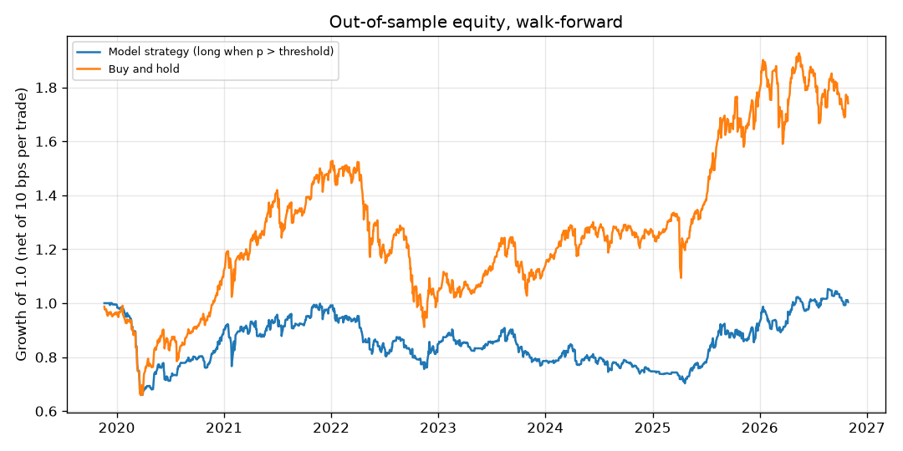
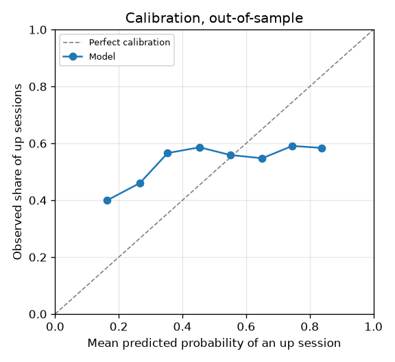
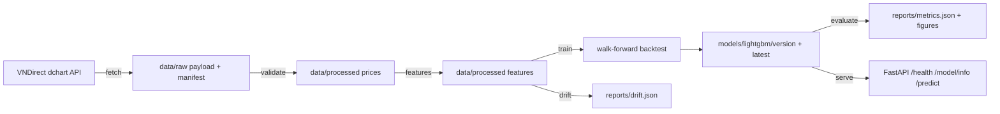

# VNINDEX next-session forecast

A leakage-safe walk-forward pipeline for VNINDEX daily direction and next-session
return, with honest baselines, a versioned model artifact, a FastAPI service and
feature drift monitoring.

## What this is

This repository predicts whether the VNINDEX index closes higher on the next
session, and how large that move is likely to be, from 18 features built on daily
OHLCV bars. Every number is produced by a walk-forward backtest with an expanding
window and no shuffling, and every headline metric is paired with a baseline that
is trivial to compute. The model is trained through a scikit-learn pipeline, stored
as an immutable version with its config hash and data SHA256, served over HTTP, and
monitored for feature drift. The result is deliberately unflattering: the model
does not beat the baselines, and the repository says so with the measured numbers.

## Why it was rebuilt

The original artifact was a coursework notebook (`legacy/VNINDEX_LSTM_Predict.ipynb`,
moved here unchanged, Vietnamese comments) that mounted Google Drive, read a
scraped CSV with Vietnamese headers, and trained a Keras LSTM on scaled closing
prices. It reported a validation loss around 2.7e-4 on scaled price levels and
plotted predicted versus actual prices, which is not a measure of directional
skill and has no baseline, no walk-forward split, no cost model and no way to
reproduce the data. The rebuild keeps the notebook as history and replaces
everything around it with a package, a CLI, a data contract, walk-forward
evaluation, a model registry, a serving contract and offline tests.

## Results

Out of sample from 2019-11-20 to 2026-10-29: 1731 sessions, 83 refits, 10 basis
points of cost per position change. Returns and drawdowns are fractions of
capital. The full report is `reports/metrics.json`.

| Metric | Model | Baseline | Baseline definition |
| --- | --- | --- | --- |
| Direction accuracy | 0.5292 | 0.5638 | majority class in the training window |
| ROC AUC | 0.5139 | 0.5000 | constant probability |
| Brier score | 0.2662 | 0.2463 | constant training base rate |
| MAE next-session log return | 0.008833 | 0.008690 | naive forecast of zero |
| Strategy total return | 0.43% | 74.06% | buy and hold |
| Annualized return | 0.06% | 8.40% | buy and hold |
| Annualized Sharpe | 0.004 | 0.397 | buy and hold |
| Max drawdown | -34.02% | -40.34% | buy and hold |
| Hit rate (long sessions) | 56.59% | 56.38% | buy and hold |
| Exposure | 65.34% | 100% | buy and hold |
| Position changes | 640 | 1 | buy and hold |

The model loses to the baseline on every metric that measures forecast quality:
accuracy, AUC, Brier and return MAE. Its lower drawdown comes from holding cash
35% of the time, not from timing. With a fixed 0.5 threshold instead of the
per-fold selected threshold the strategy returns 4.95% over the same period,
still far below buy and hold.

This is the expected outcome. Daily index direction is close to a random walk;
AUC 0.51 is what noise plus a little mean reversion looks like. The value of the
repository is the pipeline and the evaluation discipline, not alpha.

### Four methods on the same 83 walk-forward points

`evaluate` scores every method on the identical out-of-sample window, with the
same 10 bps cost and the same threshold rule. Numbers below come from the run on
2026-10-31, 1731 sessions, and are stored in `reports/metrics.json`.

| Method | Accuracy | AUC | Sharpe | Net return | 80% interval coverage | Wall time |
| --- | --- | --- | --- | --- | --- | --- |
| Naive persistence | 0.5147 | 0.5067 | 0.064 | 6.05% | n/a | 0.0 s |
| Logistic regression | 0.5552 | 0.5191 | 0.278 | 41.01% | n/a | 3.9 s |
| LightGBM | 0.5292 | 0.5139 | 0.044 | 4.95% | 0.7857 | 83.5 s |
| Chronos-2, zero shot | 0.5118 | 0.4952 | -0.229 | -20.96% | 0.7851 | 195.2 s |

Chronos-2 is the current Amazon time-series foundation model, run zero shot on
512-session contexts on CPU: 29.3 s to load, 195.2 s of inference, 112.8 ms per
point. It loses to a plain logistic regression on every metric, and the logistic
regression wins the comparison outright. That is reported here rather than
tuned away: the point of adding a foundation model is to be able to say what it
does on this data, not to assume it helps.

The split-conformal interval for the next-session log return, built from the
model's own quantiles, covers 0.7857 of walk-forward rows at a nominal 0.80
(target 0.80), with an average width of 0.0266 log points. On the last 252
sessions coverage drops to 0.7262, which is what a volatility regime change does
to a conformal band calibrated before it.



*Long-only strategy at the served threshold, net of 10 bps per position change,
against buy and hold over the out-of-sample window.*



*Predicted probability against observed frequency. The curve is flat and close
to the base rate: the classifier carries very little information.*

## Quickstart

```bash
python -m pip install -e ".[dev]"
python -m vnindex_forecast fetch
python -m vnindex_forecast validate
python -m vnindex_forecast features
python -m vnindex_forecast train
```

Then, in any order:

```bash
python -m vnindex_forecast evaluate    # metrics.json plus figures
python -m vnindex_forecast drift       # reports/drift.json
python -m vnindex_forecast drift --evidently   # + reports/drift_evidently.html
python -m vnindex_forecast serve       # http://127.0.0.1:8123/docs
```

Hyperparameters are searched on the first 500 rows only, in expanding blocks, so
the search never sees the out-of-sample window:

```bash
python -m vnindex_forecast tune --trials 30      # writes configs/tuned.yaml
```

Training with `--track` logs one MLflow run per method to `sqlite:///mlflow.db`,
registers the direction model and moves the `champion` alias to the run with the
better walk-forward accuracy. Data files are tracked with DVC (`dvc.yaml`,
`dvc repro`); the payload itself stays out of git.

`python -m pytest -q` runs the offline test suite and `python -m ruff check .`
lints the tree. Every command accepts `--config PATH` before the subcommand.

## Data

Source: the public VNDirect dchart endpoint, the same JSON payload that backs
their public price chart. No login and no key.

```
GET https://dchart-api.vndirect.com.vn/dchart/history?symbol=VNINDEX&resolution=D&from=<epoch>&to=<epoch>
```

`fetch` requests the history in two five-year chunks with a browser User-Agent,
at most one request per second, up to three retries with exponential backoff, and
writes the payload untouched to `data/raw/vnindex_daily.json` plus a sidecar
`data/raw/manifest.json` (source URL, fetch time, SHA256, row count, first and
last observation, per-chunk hashes). The tidy frame goes to
`data/processed/vnindex_daily.csv` with columns `date, open, high, low, close,
volume`.

The current snapshot holds 2292 raw observations from 2017-08-24 to 2026-10-30.
One row (2020-09-29) is removed at clean time because the upstream close was
below the day low; the manifest records it. The processed frame has 2291 rows.

No data is committed. The index history is public market data, but it is
re-fetched and gitignored so the repository never redistributes a snapshot that
may be stale or differently licensed. Re-running `fetch` is a no-op while the
cached payload and manifest agree; `fetch --force` refreshes.

## Architecture



`fetch` is the only step that touches the network. `validate` enforces the data
contract and exits non-zero on failure. `features` builds the leakage-safe frame.
`train` runs the backtest, selects the served threshold on a time-ordered holdout,
fits the final models and writes the artifact. `evaluate` scores the latest
artifact and writes metrics and figures. `drift` compares the last 252 sessions
with the training reference. `serve` loads `models/latest` at startup.

### What is modern in this repository

The first rebuild had the right protocol and plain tooling. The current tree
replaces the hand-written parts with the libraries a production team uses:

| Concern | Library | Where |
| --- | --- | --- |
| Experiment tracking and registry | MLflow 3 (SQLite store, `champion` alias) | `src/vnindex_forecast/tracking/mlflow.py` |
| Hyperparameter search | Optuna 5, TPE + MedianPruner, storage `reports/optuna.db` | `src/vnindex_forecast/tuning/search.py` |
| Data contract | Pandera 0.35 schema | `src/vnindex_forecast/data/contracts.py` |
| Data versioning | DVC 3 | `dvc.yaml`, `dvc.lock` |
| Drift report | Evidently 0.7 (HTML + JSON alongside the PSI) | `src/vnindex_forecast/monitor/evidently_report.py` |
| Interval forecasts | split conformal on the model's own quantiles | `src/vnindex_forecast/models/conformal.py` |
| Foundation model | Chronos-2, `amazon/chronos-2`, zero shot on CPU | `src/vnindex_forecast/models/chronos.py` |
| Feature attribution | SHAP tree values in the service response | `src/vnindex_forecast/models/explain.py` |

CI runs three jobs: the core suite on every push, a `modern` job that installs
the tracking and tuning extras but not torch, and a `deep` job that downloads
Chronos-2 weights and only runs on `workflow_dispatch`, because a model that
needs 29 s to load and 195 s to score does not belong in a push-triggered build.

## Model card

Summary: LightGBM classifier for direction plus LightGBM regressor for the next
log return, 18 features, 60-bar minimum window, seed 42, served threshold 0.57.
Full card in [`docs/model_card.md`](docs/model_card.md), which covers intended
use, out of scope, calibration and the fact that no baseline is beaten.

## Monitoring

`python -m vnindex_forecast drift` computes population stability index per feature
between the earlier 70% of the feature history (2017-11-16 to 2024-02-21) and the
last 252 sessions (2025-10-24 to 2026-10-29). The current run reports 7 stable,
7 moderate and 4 significant features:

| Feature | PSI | Status | Standardized mean shift |
| --- | --- | --- | --- |
| atr_14_norm | 3.60 | significant | +0.52 |
| ret_std_60 | 2.45 | significant | +0.23 |
| ret_mean_60 | 1.51 | significant | +0.03 |
| ret_std_20 | 1.01 | significant | +0.14 |

The 2025-2026 volatility regime is much calmer than the 2017-2024 reference,
so the volatility features barely overlap. PSI is unbounded when reference bins
receive no current observations; values above 1.0 mean separation, not a
calibrated distance. A monitoring job should treat `significant` as a trigger to
retrain and re-run the backtest, not as proof that the model degraded in a
specific direction.

The service exposes `/health` (loaded or degraded, model version) and
`/model/info` (version, threshold, metrics, feature list, data hash) so that a
deployment can be checked without reading files. `POST /predict` takes the last
60 daily bars and returns the probability of an up session, the predicted log
return, the decision at the stored threshold and the model version.
`POST /predict/batch` accepts up to 100 windows.

## Limitations

* The model does not beat any baseline on forecast quality. Accuracy 0.5292 is
  below the 0.5638 majority class; Brier 0.2662 is worse than a constant; return
  MAE 0.008833 is worse than predicting zero.
* The strategy result is unstable. An earlier run of the same code with one extra
  warm-up row produced +55% total return instead of +0.43%, from the same data and
  the same 83 refits. A result that moves that much across a one-row shift in the
  evaluation grid is noise, and the repository reports the lower run.
* Probabilities are not calibrated. The calibration plot stays between 0.40 and
  0.60 observed while predictions range from 0.17 to 0.83. The conformal interval
  does not fix that: it covers 0.7857 of walk-forward rows at a nominal 0.80, and
  only 0.7262 on the last 252 sessions, because a band calibrated in one
  volatility regime is too narrow in the next.
* The foundation model is expensive and did not pay for itself. Chronos-2 needs
  195.2 s of CPU inference for the same 1731 points that cost LightGBM 83.5 s and
  logistic regression 3.9 s, and scores below both. It stays in the repository as
  a measured baseline, not as the recommended model.
* TabPFN is not included. The 3.5 release requires a Hugging Face login and
  licence acceptance before it will download weights, and the 2.2 release pins
  `pandas<3` and `scikit-learn<1.7`, which conflicts with the rest of the stack.
  Downgrading the whole environment for one candidate was not worth it.
* The threshold is selected on 126 training rows per fold, which is a very noisy
  estimate. The served threshold (0.57) was selected once on the last 252 rows and
  is not re-validated after deployment.
* Costs are a flat 10 basis points per position change. There is no slippage
  model, no tax, no borrow and no liquidity constraint, and the strategy assumes a
  long-only position can always be entered or exited at the close.
* The target is the VNINDEX index level, which is not directly tradable. A real
  implementation would trade an ETF or futures contract with different costs,
  tracking error and trading hours.
* The data comes from a public chart endpoint, not an official exchange feed. It
  is not adjusted for index methodology changes, and one malformed row had to be
  dropped. There is no dividend or corporate action handling because the target is
  an index level rather than a total return series.
* One symbol, one market, one frequency. Nothing here generalises to intraday
  data or to other indices without rebuilding the features and re-running the
  backtest.
* The original notebook's validation loss is not comparable to anything here: it
  is squared error on scaled price levels, not a directional or return-level
  metric, and it was measured on a single holdout without costs or baselines.

## Project layout

```
.
|-- configs/base.yaml                 # every runtime parameter
|-- data/raw/                         # fetched payload, manifest (gitignored)
|-- data/processed/                   # tidy prices, features (gitignored)
|-- docs/model_card.md
|-- legacy/VNINDEX_LSTM_Predict.ipynb # original coursework, unchanged
|-- models/<model>/<version>/         # model.joblib + metadata.json (gitignored)
|-- reports/                          # metrics.json, drift.json, figures
|-- src/vnindex_forecast/
|   |-- cli.py                        # fetch, validate, features, train, evaluate, drift, serve
|   |-- config.py                     # typed YAML config, path resolution, hashing
|   |-- data/fetch.py                 # HTTP client, cache, manifest
|   |-- data/validate.py              # data contract
|   |-- features/build.py             # leakage-safe features
|   |-- models/factory.py             # sklearn pipelines
|   |-- models/train.py               # backtest, threshold, final fit
|   |-- models/evaluate.py            # metrics, figures
|   |-- models/registry.py            # versioned artifacts
|   |-- monitor/drift.py              # PSI per feature
|   `-- serving/app.py                # FastAPI
`-- tests/                            # offline, synthetic fixtures only
```

## License

MIT, copyright Hoang Hieu Nguyen. See `LICENSE`. Market data remains subject to
the terms of its source.
